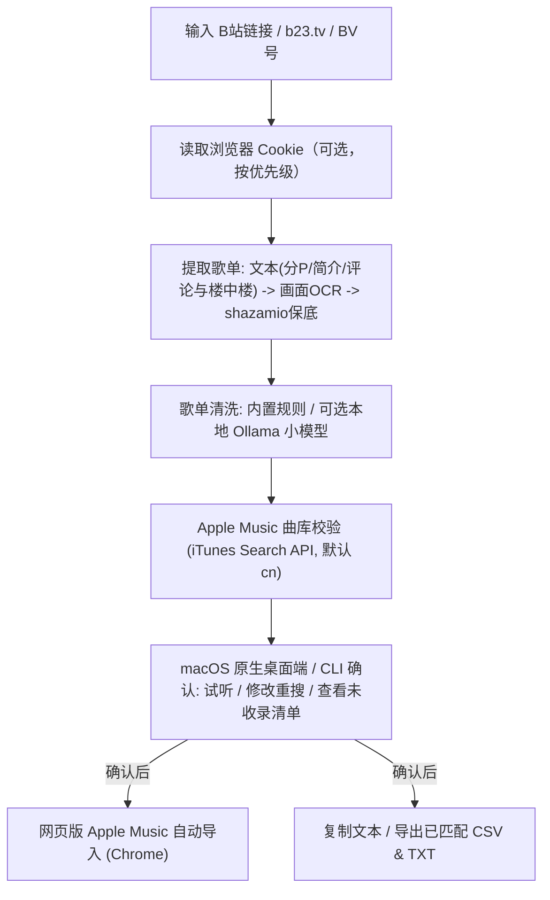

# bili2am

[](https://github.com/<your-username>/bili2am/actions/workflows/ci.yml)


**bili2am** 是一个面向 macOS 的开源工具，用于从 B 站音乐大合集视频中自动提取歌单、校验目标地区 Apple Music 曲库收录情况，并在本地原生桌面应用或命令行确认后导入 Apple Music。

---

## 核心特性

1. **三级瀑布流歌单提取**
   - **第一级（文本元数据）**：秒级抓取 B 站分 P 选集、视频分段章节、简介、字幕，以及评论区翻页与“楼中楼”回复中的歌单时间轴。
   - **第二级（macOS 原生 Vision OCR）**：文本区未写歌单时，通过 `yt-dlp` + `ffmpeg` 抽帧，并调用 macOS 原生 Apple Vision（`swiftc` 编译 `VNRecognizeTextRequest`）识别画面歌名并做相邻帧去重，无需下载笨重的第三方 OCR 模型。
   - **第三级（`shazamio` 听歌识曲保底）**：既无文字又无画面歌名时，自动通过静音检测或定时分段采样音频，调用 `shazamio` 批量识别并去重。
2. **原生 macOS 桌面应用（SwiftUI）+ 完整 CLI**
   - **Apple HIG 双栏设计**：左侧为无上限本地历史记录侧边栏（支持检索、单条删除、清空及失败记录回溯），右侧为居中启动页与歌单确认工作区。
   - **三阶段实时进度条**：识别提取、Apple Music 匹配、Chrome 网页导入全程展示实时进度。
   - **失败项手动重试 & 系统通知**：支持解析失败一键重跑、导入失败单曲/批量重试；无论成功或失败均发送 macOS 系统通知。
   - **保留完整 CLI**：支持纯命令行模式（`--cli-only`）与本地网页模式（`--web`）。
3. **智能清洗（规则 + 可选本地小模型）**
   - 默认零额外成本，使用内置正则与启发式规则剥离时间戳、序号、`【Hi-Res】` 等噪声并拆分歌手与歌名。
   - 支持**可选**接入本地 **Ollama** 小模型（如 `qwen2.5:1.5b` / `qwen2.5:3b` / `qwen3:4b`）或兼容 OpenAI 的 API。**默认不会自动下载任何模型**，如需使用可在设置面板中按需手动触发下载。
4. **Apple Music 曲库预校验（默认国区 `cn`，无需付费开发者账号）**
   - 调用 Apple 官方公开免费的 iTunes Search API（结合 `isStreamable`），在导入前提前识别：
     - ✅ **曲库已匹配**
     - ⚠️ **待人工确认**（如译名差异、Live/Remix 版本）
     - ❌ **曲库未收录**（会在确认页与终端明确写出清单，**不导入、也不额外导出缺失文件**）
   - 支持修改歌手/歌名重新检索、切换 Top 3 候选版本、**在线试听 30 秒片段**。
5. **多种导入与导出途径**
   - **🌐 网页版 Apple Music 自动导入（推荐）**：通过 Playwright 复用本机已安装的 Chrome（无需下载额外 Chromium，使用独立配置目录隔离日常浏览并通过系统钥匙串保存登录态），首次登录后即可稳定按网页 DOM 点击「添加到歌单」。
   - **一键复制 / 导出 CSV & TXT**：仅包含确认后的可播曲目，可直接粘贴或上传到 TuneMyMusic / Soundiiz 导入。
6. **透明可控的浏览器 Cookie 策略**
   - 支持开关与优先级配置（默认 `safari -> edge -> chrome`），每次运行均会明确告知用户读取了哪个浏览器或为何降级为匿名模式；Cookie 仅在本地内存中用于本次请求，绝不写入日志或上传。

---

## 整体流程



---

## 快速安装

### 1. 系统依赖（macOS）

```bash
brew install ffmpeg
xcode-select --install  # 提供 swiftc，用于编译原生 Vision OCR
```

### 2. 安装 bili2am

```bash
git clone https://github.com/<your-username>/bili2am.git
cd bili2am

# 基础安装（含文本提取、Apple Vision OCR、Web 确认页、Chrome 网页端导入与文件导出）
pip install -e .

# 如需启用 shazamio 听歌识曲保底（推荐）
pip install -e ".[shazam]"
```

### 3. 构建独立 macOS 桌面应用（可选，推荐）

```bash
bili2am build-app
```

生成位于 `dist/bili2am.app` 的原生 SwiftUI 桌面程序（遵循 macOS 原生视觉规范，可双击运行或在 `bili2am` 命令下自动拉起）。

### 4. 运行环境自检

```bash
bili2am doctor
```

---

## 使用方法

```bash
# 直接启动独立 macOS 桌面应用
bili2am

# 传入 B 站视频链接或 BV 号（在独立桌面应用中打开并自动解析）
bili2am https://www.bilibili.com/video/BV1xx411c7mD

# 纯命令行模式（不启动图形界面，直接在终端确认并导入）
bili2am BV1xx411c7mD --cli-only

# 备选：使用本地浏览器网页界面
bili2am BV1xx411c7mD --web

# 强制使用画面 OCR 或 shazamio 识曲，并指定美区曲库
bili2am BV1xx411c7mD --mode ocr --storefront us

# 禁用浏览器 Cookie（纯匿名模式），或在终端直接确认
bili2am BV1xx411c7mD --no-cookies --cli-only

# 指定 Cookie 浏览器优先级
bili2am BV1xx411c7mD --cookie-browsers chrome,edge,safari

# 生成/查看默认配置文件（~/.config/bili2am/config.toml）
bili2am config --init
bili2am config
```

---

## 本地小模型（可选）说明

如果你经常处理极其杂乱的热评或画面 OCR 文本，可在本地安装 [Ollama](https://ollama.com) 后，在 Web 界面右上角 **「⚙️ 设置与本地模型」** 中按需下载轻量模型（**项目本身不会自动下载任何模型文件**）：

- `qwen2.5:1.5b`（~1.0 GB）：最小可用档，适合基础中英文清洗。
- `qwen2.5:3b`（~1.9 GB，**推荐**）：中英日歌名识别稳健，JSON 格式稳定，体积与效果平衡最佳。
- `qwen3:4b`（~2.6 GB）：适合较复杂的 OCR 残片清洗。

---

## 隐私与合规声明

- 本工具仅在本地运行，仅访问用户主动输入的 B 站公开视频页面与元数据接口。
- 浏览器 Cookie 读取功能完全可开关；读取到的 Cookie 仅保存在当次进程内存中，不会持久化、不会写入日志、也不会发送给任何第三方。
- Apple Music 曲库校验使用苹果公开的 iTunes Search API 与官方网页端目录；导入操作通过用户本地 Chrome 登录网页版官方播放器或标准歌单文本导出完成，不涉及任何 DRM 破解或未授权接口绕过。

---

## 开发与测试

```bash
pip install -e ".[dev]"
ruff check src tests scripts
pytest -v
```

## License

[MIT](LICENSE)
